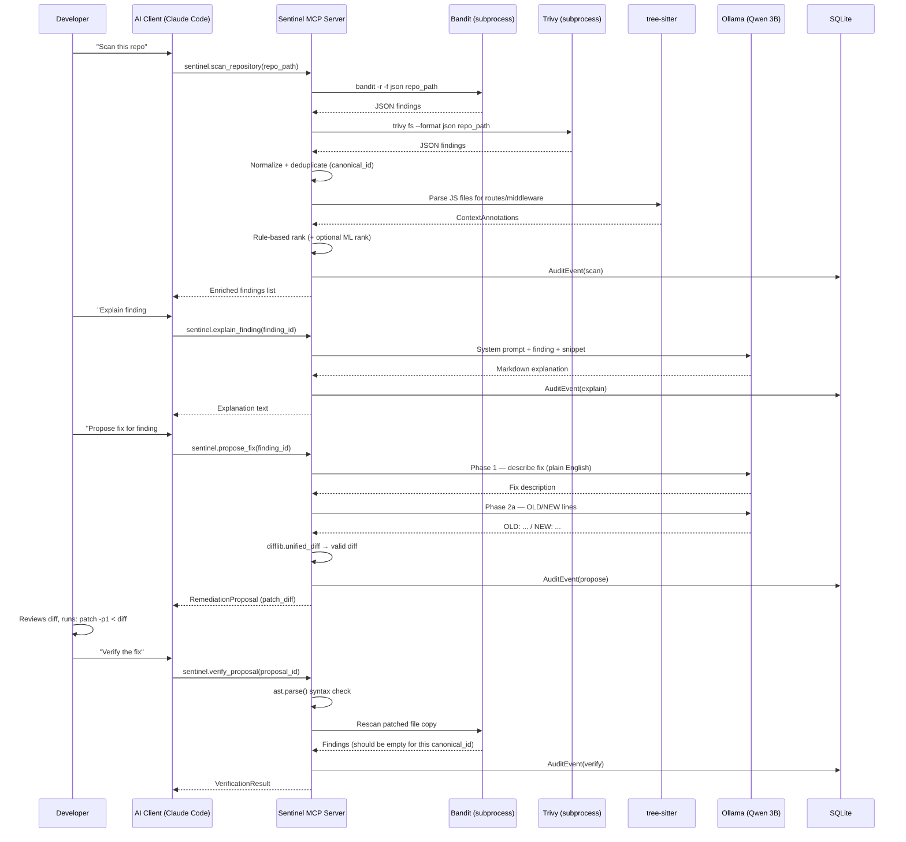

# 04 — Recommended Architecture

## 1. Component Inventory

Sentinel's source tree contains 13 modules, each with a single responsibility:

```
src/sentinel/
├── server.py           # MCP server, tool registration, request dispatch
├── orchestrator.py     # Pipeline: scan → normalize → enrich → rank → explain
├── schemas.py          # All Pydantic v2 data contracts
├── normalizer.py       # RawFinding → SecurityFinding, canonical_id dedup
├── ranker.py           # RuleBasedRanker + RankerProvider ABC
├── remediation.py      # PatchGenerator → unified diff (no apply logic)
├── verification.py     # SyntaxChecker + RescanEngine
├── audit.py            # AuditEvent, SQLite append-only log
├── report.py           # JSON + static HTML report generator
├── cli.py              # `sentinel` CLI entry point
├── scanners/
│   ├── base.py         # ScannerAdapter ABC
│   ├── bandit.py       # BanditAdapter: subprocess + JSON parse
│   └── trivy.py        # TrivyAdapter: subprocess + JSON parse
├── context/
│   ├── extractor.py    # tree-sitter Express.js route + middleware extraction
│   └── graph.py        # NetworkX graph, two structural claims
├── llm/
│   ├── base.py         # LLMProvider ABC
│   └── ollama.py       # OllamaProvider: POST localhost:11434/v1/chat/completions
└── ml/
    ├── features.py     # 13-dimensional feature extraction
    └── ranker.py       # MLRanker (Logistic Regression / Random Forest)
```

---

## 2. Data Contracts (Pydantic v2)

All inter-component data is typed and validated by Pydantic models defined in `schemas.py`.

### SecurityFinding
```python
class SecurityFinding(BaseModel):
    canonical_id: str        # sha256(file_path + line_start + cwe_id) — dedup key
    id: str                  # UUID per finding instance
    scanner: str             # "bandit" | "trivy"
    rule_id: str             # e.g. "B311", "CVE-2023-12345"
    file_path: str           # POSIX path relative to repo root
    line_start: int
    line_end: int
    severity: Literal["critical","high","medium","low","info"]
    confidence: Literal["high","medium","low"]
    cwe_id: Optional[str]
    message: str
    snippet: Optional[str]   # ≤10 lines of source context
    is_dev_dependency: bool  # Trivy: dev dependency flag
```

### ContextAnnotation
```python
class ContextAnnotation(BaseModel):
    route_path: Optional[str]          # e.g. "/api/users/:id"
    http_methods: list[str]            # ["GET","POST"]
    middleware_names: list[str]        # Structural presence only
    attribution_confidence: Literal["file","handler","unknown"]
    disclaimer: str = (
        "Structural analysis only. Middleware names are not verified "
        "as enforcement mechanisms. This does not imply exploitability."
    )
```

### RiskAssessment
```python
class RiskAssessment(BaseModel):
    finding_id: str
    ranked_severity: Literal["critical","high","medium","low"]
    ranker: Literal["rule_based","ml"]
    score: float                        # 0.0–1.0
    feature_breakdown: dict[str, float] # Every feature and weight visible
    context_factors: list[str]          # Human-readable factor explanations
```

### RemediationProposal
```python
class RemediationProposal(BaseModel):
    finding_id: str
    patch_diff: str              # Unified diff — display only, never applied
    rationale: str
    generated_by: str            # e.g. "qwen2.5-coder:3b+difflib", "rule_based"
    requires_developer_action: bool = True   # Always True (enforced in model_post_init)
```

### VerificationResult
```python
class VerificationResult(BaseModel):
    proposal_id: str
    syntax_ok: bool
    rescan_clear: bool           # Original canonical_id absent in rescan
    overall: Literal[
        "undetected_by_rescan", "still_detected",
        "syntax_error", "inconclusive"
    ]
    disclaimer: str = (
        "Rescan clear does not prove the vulnerability is fixed. "
        "Manual review required."
    )
```

### AuditEvent
```python
class AuditEvent(BaseModel):
    timestamp: datetime
    event_type: str
    repository_root: str
    finding_canonical_id: Optional[str]
    action: str
    outcome: str
    metadata: dict
```

---

## 3. MCP Tool Definitions

| Tool | Read/Write | Description |
|---|---|---|
| `sentinel.ping` | Read | Environment health check. Returns version, Python version, Ollama status. |
| `sentinel.scan_repository` | Read | Run Bandit + Trivy; normalize; enrich with context; rank. Returns enriched findings with `ContextAnnotation` and `RiskAssessment`. |
| `sentinel.explain_finding` | Read | LLM explanation for one finding using snippet + context. Returns markdown. |
| `sentinel.propose_fix` | Read | Unified diff for one finding. Returns `RemediationProposal`. Never applies. |
| `sentinel.verify_proposal` | Read | Syntax check + rescan for a finding after manual patch application. Returns `VerificationResult`. |
| `sentinel.get_audit_history` | Read | Returns recent `AuditEvent` list for a repository. |
| `sentinel.report` | Read | Generates JSON + static HTML report to a specified output path. |

**All tools are read-only** from the MCP perspective — none modifies the target repository.

---

## 4. Context Graph: Honest Scope

The context graph (NetworkX, in-memory) supports **two structural claims only**:

**Claim 1 — File-level attribution:**
> "This finding's file is imported/required by handler X, which is registered on route Y."

**Claim 2 — Middleware presence:**
> "Route Y has middleware [names] declared before the handler."

### What the graph explicitly does NOT claim:
- Whether middleware actually enforces authentication at runtime.
- Whether user-controlled input reaches the vulnerable code path.
- Whether the vulnerability is exploitable.

These limitations are stated in `ContextAnnotation.disclaimer` on every output and cannot be suppressed.

### Graph schema:
- `Route` nodes: path pattern, HTTP methods
- `Handler` nodes: file path, function name
- `Middleware` nodes: function names in call order
- `File` nodes: all scanned files
- Edges: `HAS_HANDLER`, `HAS_MIDDLEWARE`, `IMPORTS`

---

## 5. Security Constraints

| Constraint | Implementation |
|---|---|
| No code execution from repo | tree-sitter parses to CST only; `subprocess.run()` used only for scanners with fixed arguments |
| Prompt injection prevention | File snippets wrapped in `<untrusted_source_code>` delimiters; system prompt states content is untrusted |
| Path traversal prevention | All `repo_path` values validated to resolve under confirmed directory before any file read |
| Scanner output safety | Bandit/Trivy output parsed as JSON in dedicated function; never `eval()`d or `exec()`d |
| Secret value protection | Trivy findings stored as type + location only; no raw secret values in `SecurityFinding` or audit log |
| No auto-apply | `requires_developer_action: bool = True` enforced in `model_post_init`; cannot be set to False |

---

## 6. Pipeline Sequence Diagram


