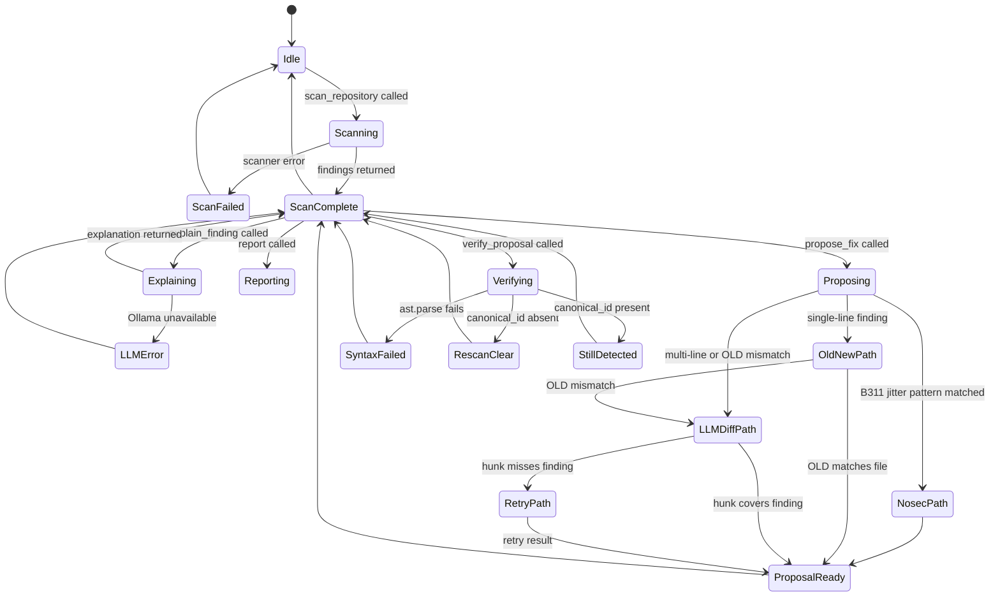

# 05 — End-to-End Workflow

## 1. Overview

A complete Sentinel scan cycle involves seven stages, from the developer's request to a verified patch. This document walks through each stage in detail, describing inputs, processing, outputs, and failure modes.

---

## 2. Stage 1 — Repository Scan (`sentinel.scan_repository`)

**Input:** `repo_path` — absolute path to the repository root on the local machine.

**Processing:**

1. **Path validation** — `repo_path` is resolved with `Path.resolve()` and checked to exist. Symlink traversal is permitted only within the confirmed root.
2. **Bandit scan** — `subprocess.run(["bandit", "-r", "-f", "json", repo_path], capture_output=True)`. Output parsed as JSON. Each finding mapped to `RawFinding`.
3. **Trivy scan** — `subprocess.run(["trivy", "fs", "--format", "json", repo_path], capture_output=True)`. Output parsed. Vulnerabilities and secrets mapped to `RawFinding`.
4. **Normalization** — `FindingNormalizer` maps `RawFinding → SecurityFinding`. `canonical_id = sha256(file_path + str(line_start) + (cwe_id or ""))`. Duplicate `canonical_id` entries are merged (last scanner wins).
5. **Context extraction** — `ContextGraphBuilder` uses tree-sitter to parse `*.js` files, extracts Express.js routes (`app.get(...)`, `router.post(...)`, etc.) and middleware chains. Each `SecurityFinding` is enriched with a `ContextAnnotation` via file-level attribution.
6. **Ranking** — `RuleBasedRanker` computes a score from severity, confidence, CWE category weight, and context factors (exposed route bonus, authenticated middleware penalty). Findings sorted by score descending.
7. **Audit log** — `AuditEvent(event_type="scan", ...)` written to SQLite.

**Output:** List of `EnrichedFinding` (finding + context + risk assessment), summary counts by severity and scanner, `scan_id`.

**Failure modes:**
- Bandit not installed → `ScannerError` with installation hint.
- Trivy not installed or database stale → `ScannerError`.
- Zero findings → empty list returned (not an error).

---

## 3. Stage 2 — Explanation (`sentinel.explain_finding`)

**Input:** `finding_id` from a prior scan, `repo_path`.

**Processing:**

1. Finding retrieved from scan cache by `finding_id`.
2. `OllamaProvider.complete()` called with:
   - System prompt: security engineer persona, one-paragraph explanation format.
   - User prompt: finding metadata + snippet + context annotation.
3. `temperature: 0.1`, `top_p: 0.9`, `repeat_penalty: 1.1`.
4. `AuditEvent(event_type="explain")` written.

**Output:** Markdown string explaining the vulnerability, its risk, and suggested fix direction.

**Failure modes:**
- Ollama not running → `LLMProviderError` with hint to run `ollama serve`.
- Model not loaded → `LLMProviderError` with hint to run `ollama pull qwen2.5-coder:3b`.

---

## 4. Stage 3 — Patch Proposal (`sentinel.propose_fix`)

This is the most complex stage. `PatchGenerator.generate()` follows a prioritised three-path strategy:

### Path 1 — nosec Fast Path (no LLM call)

For findings matching known low-risk patterns (currently B311 on `random.uniform/randint/random/choice`), a `# nosec B311` comment is appended to the flagged line using `difflib`-reconstructed diff. No LLM call is made.

**When used:** Rule ID matches `_NOSEC_PATTERNS` AND the snippet matches the pattern regex.

**Output:** Precise, correct diff. `generated_by: "rule_based"`.

### Path 2 — OLD/NEW + difflib Reconstruction (primary LLM path, single-line findings)

**Phase 1 — Describe (LLM call 1):**
- System: "Respond with exactly two lines: what is wrong, what the fix is."
- Model outputs a plain-English fix description.

**Phase 2a — OLD/NEW lines (LLM call 2):**
- System: "Output exactly: `OLD: <line>` / `NEW: <line>`."
- Model outputs only two lines — no diff syntax.
- Python verifies `OLD` matches the actual file line (strip-compare).
- `difflib.unified_diff` reconstructs a valid, correctly-formatted diff preserving original indentation.

**When used:** Single-line finding (`line_start == line_end`) AND OLD line matches file.

**Output:** Guaranteed-valid diff. `generated_by: "<model>+difflib"`.

### Path 3 — Full LLM Diff (fallback)

**Phase 2b — Full diff (LLM call 2 or 3):**
- System: "Return ONLY a unified diff. Few-shot example provided."
- User prompt includes `>>>` marker on the vulnerable line, fix description.
- `_hunk_lines_valid()` checks all hunk lines start with ` `, `-`, `+`, or `\`.
- `_patch_covers_finding()` checks hunk is within 5 lines of the finding.
- If coverage check fails: one retry with explicit line number and previous output.

**When used:** Multi-line findings, or when Path 2 fails.

**Output:** LLM-formatted diff with validation. `generated_by: "<model>"`.

---

## 5. Stage 4 — Manual Application (Developer)

The developer reviews the `patch_diff` and applies it manually:

```bash
patch -p1 < sentinel_fix.diff
# or
git apply sentinel_fix.diff
```

Sentinel never performs this step. This is a hard architectural constraint, not a limitation.

---

## 6. Stage 5 — Verification (`sentinel.verify_proposal`)

**Input:** `proposal_id`, `repo_path`.

**Processing:**

1. **Syntax check** — For Python files: `ast.parse(patched_content)`. For JS files: `node --check file.js` subprocess. Failure → `syntax_ok: False`, overall: `"syntax_error"`.
2. **Rescan** — Bandit re-run on the patched file (or file copy with patch applied in memory). Check whether the original `canonical_id` appears in results.
3. **Result classification:**
   - `canonical_id` absent → `rescan_clear: True`, overall: `"undetected_by_rescan"`
   - `canonical_id` present → `rescan_clear: False`, overall: `"still_detected"`
   - Rescan error → overall: `"inconclusive"`
4. **Disclaimer always attached:** "Rescan clear does not prove the vulnerability is fixed. Manual review required."
5. `AuditEvent(event_type="verify")` written.

**What this stage does NOT claim:** The vulnerability is fully remediated. A scanner may miss a re-introduced vulnerability. Human review is always required.

---

## 7. Stage 6 — Audit History (`sentinel.get_audit_history`)

**Input:** `repo_path`, optional `limit`.

**Output:** Recent `AuditEvent` list ordered by timestamp descending. Each event records: timestamp, event type, repository root, finding canonical ID, action, outcome, and metadata.

---

## 8. Stage 7 — Report Generation (`sentinel.report`)

**Input:** `repo_path`, `output_path`.

**Processing:**
1. Load all findings from last scan.
2. Render JSON report (full structured data).
3. Render static HTML report (single file, no server): severity breakdown bar chart, findings table with filtering, per-finding detail accordion.

**Output:** `report.json` and `report.html` at `output_path`.

---

## 9. State Machine



---

## 10. Data Flow Summary

```
repo_path (validated)
    │
    ├─▶ Bandit subprocess ──▶ RawFinding[]
    ├─▶ Trivy subprocess  ──▶ RawFinding[]
    │
    ▼
FindingNormalizer ──▶ SecurityFinding[] (canonical_id deduped)
    │
    ▼
ContextGraphBuilder (tree-sitter) ──▶ ContextAnnotation per finding
    │
    ▼
RuleBasedRanker / MLRanker ──▶ RiskAssessment per finding
    │
    ▼
EnrichedFinding[] (finding + context + risk) ──▶ MCP client
    │
    ├─▶ OllamaProvider ──▶ Explanation (markdown)
    │
    ├─▶ PatchGenerator ──▶ RemediationProposal (unified diff)
    │       ├─ nosec fast path (rule_based)
    │       ├─ OLD/NEW + difflib (model+difflib)
    │       └─ LLM full diff + retry (model)
    │
    ├─▶ VerificationEngine ──▶ VerificationResult
    │
    └─▶ SQLite AuditLog ──▶ AuditEvent[]
                          └─▶ JSON + HTML Report
```
